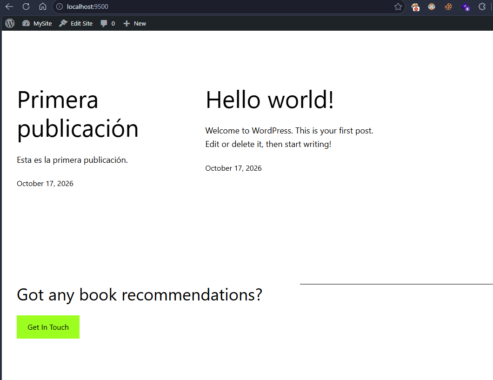

## Esquema para el ejercicio


### Crear red net-wp
```
docker network create net-wp
```

### Para que persista la información es necesario conocer en dónde mysql almacena la información.
En el esquema del ejercicio la carpeta del contenedor (a) es /var/lib/mysql

Ruta carpeta host: .../ejercicio3/db

### ¿Qué contiene la carpeta db del host?
La carpeta db del host está vacía en este momento de la práctica.

### Crear un contenedor con la imagen mysql:8  en la red net-wp, configurar las variables de entorno: MYSQL_ROOT_PASSWORD, MYSQL_DATABASE, MYSQL_USER y MYSQL_PASSWORD
```
docker run -d --name mysql --network net-wp -v C:\Users\josu\Desktop\practicas_const\practica1_Docker\ejercicio3\db:/var/lib/mysql -e MYSQL_ROOT_PASSWORD=root123 -e MYSQL_DATABASE=wordpress -e MYSQL_USER=josue -e MYSQL_PASSWORD=josue123 mysql:8
```

### ¿Qué observa en la carpeta db que se encontraba inicialmente vacía?
Al inicializarse el contenedor, MySQL llena la carpeta con la estructura básica de la base de datos (archivos de sistema, esquemas iniciales, tablas, etc).

### Para que persista la información es necesario conocer en dónde wordpress almacena la información.
En el esquema del ejercicio la carpeta del contenedor (b) es /var/www/html

Ruta carpeta host: .../ejercicio3/www

### Crear un contenedor con la imagen wordpress en la red net-wp, configurar las variables de entorno WORDPRESS_DB_HOST, WORDPRESS_DB_USER, WORDPRESS_DB_PASSWORD y WORDPRESS_DB_NAME (los valores de estas variables corresponden a los del contenedor creado previamente)
```
docker run -d --name wordpress --network net-wp -p 9500:80 -v C:\Users\josu\Desktop\practicas_const\practica1_Docker\ejercicio3\www:/var/www/html -e WORDPRESS_DB_HOST=mysql -e WORDPRESS_DB_USER=josue -e WORDPRESS_DB_PASSWORD=josue123 -e WORDPRESS_DB_NAME=wordpress wordpress
```

### Personalizar la apariencia de wordpress y agregar una entrada


### Eliminar el contenedor y crearlo nuevamente, ¿qué ha sucedido?
Al crear nuevamente el contenedor de wordpress se puede observar que la información y configuración anterior persiste. Al ingresar nuevamente a la aplicación en el navegador, el tema seleccionado y la entrada creada permanecen visibles.

